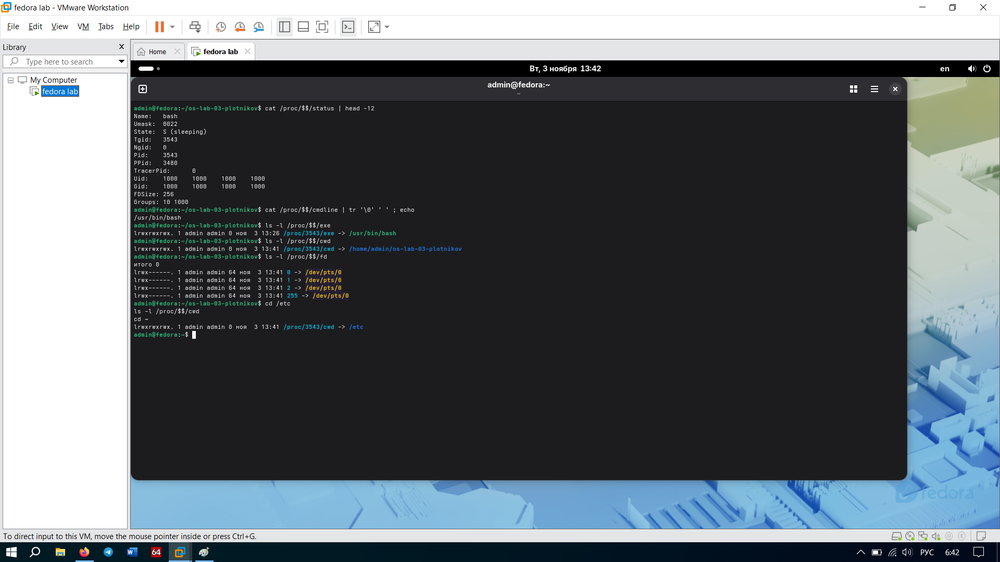

# Задание 2. Паспорт процесса через /proc

## Собрали досье на процесс
На основе данных из каталога `/proc/$$` накатали паспорт текущей оболочки:

| Параметр | Значение |
| :--- | :--- |
| **Имя процесса** | bash |
| **PID** | 3543 |
| **PPID** | 3480 |
| **UID** | 1000 (admin) |
| **Состояние** | S (sleeping) |
| **Исполняемый файл** | /usr/bin/bash |
| **Текущий каталог (cwd)** | /home/admin/os-lab-03-plotnikov |

## Отвечаем на вопросы
**Что за дескрипторы 0, 1 и 2 в /proc/$$/fd?**
Это стандартные потоки ввода/вывода (Standard I/O). Все они ведут на `/dev/pts/0` (наш виртуальный терминал):
*   `0` (stdin) — труба ввода (сюда мы пишем команды).
*   `1` (stdout) — труба вывода (сюда выводится результат).
*   `2` (stderr) — труба для ошибок.

**Что изменилось в cwd после `cd /etc` и почему?**
Ссылка `cwd` переобулась и стала указывать на `/etc`. Почему? Потому что `cd` меняет текущую рабочую директорию самого процесса оболочки (`bash`), а `/proc/$$/cwd` в реальном времени просто показывает, где мы сейчас находимся.

**Почему ps и top показывают те же сведения, что и /proc?**
Да потому что они сами ничего не выдумывают! `ps` и `top` при работе просто читают файлы из виртуальной папки `/proc` (типа `/proc/[PID]/status`) и красиво форматируют этот текст для вывода на экран.

## Скриншоты
*   `
