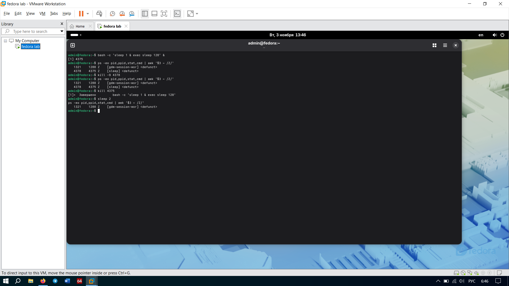

# Задание 3. Зомби-процесс

## Как мы это провернули
Замутили зомби-процесс по классике через команду `bash -c 'sleep 1 & exec sleep 120' &`. 
Прогнали проверку `ps -eo pid,ppid,stat,cmd | awk '$3 ~ /Z/'` и выкупили пассажира со статусом `Z` и командой `[sleep] <defunct>`. (Там еще висит системный зомби `[gdm-session-wor]` — это фича самой Fedora, на него можно забить).
Наш зомби: PID **4378**, а его родитель (PPID) — **4375**.

Пытались его вырубить через `kill -9 4378` — по нулям, он остался в системе. 
Но как только мы прибили родителя (`kill 4375`), наш зомби благополучно исчез.

## Отвечаем на вопросы
**Почему `kill -9` не подействовал на зомби?**
Бро, тут всё просто: зомби — это уже по сути труп. Он уже завершил свою работу, но висит в таблице процессов, потому что его родитель еще не забрал его код завершения (не вызвал `wait()`). `SIGKILL` (kill -9) нужен, чтобы прервать выполнение процесса, но зомби уже не выполняется. Стрелять в мертвого бесполезно.

**Почему зомби исчез после завершения родителя?**
Как только родитель склеил ласты, зомби «усыновил» главный босс системы — `systemd` (PID 1). Он сразу подсуетился, вызвал `wait()`, забрал код завершения, и запись о зомби испарилась. База.

**Чем опасна ситуация, когда в системе тысячи зомби?**
Это полный кринж и жесть для системы. Таблица процессов у ядра не резиновая. Каждый зомби занимает там свою ячейку. Если их станет слишком много, таблица просто переполнится, и система не сможет создавать новые процессы. В итоге получим полный фриз и зависание.

## Скриншоты
*   `
