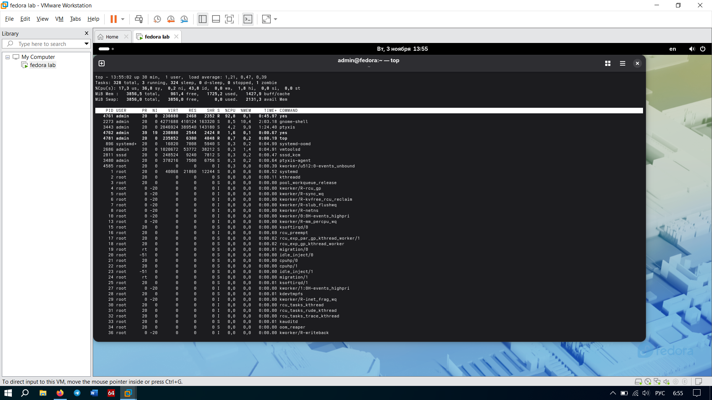
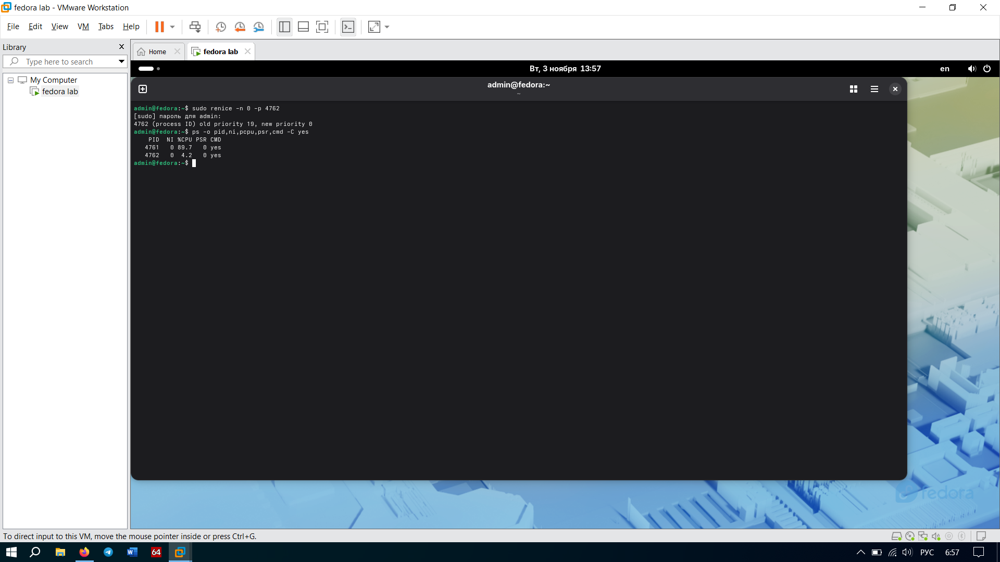

# Задание 5. Приоритеты

## Что мутили
Запустили два процесса `yes`, которые грузят процессор на 100%. Чтобы они реально конкурировали, прижали их к одному ядру командой `taskset -c 0`. 
Одному дали стандартный приоритет (`nice 0`, PID 4761), а второму — самый низкий (`nice 19`, PID 4762).

В выводе `top` (отсортировано по CPU) было видно, что процесс с `nice 0` забрал себе **95.1%** процессорного времени, а процесс с `nice 19` довольствовался лишь **1.7%**. Это база: более высокий приоритет душит низкий.

После выполнения команды `sudo renice -n 0 -p 4762` приоритет второго процесса поднялся до 0. В выводе `ps` стало видно, что теперь оба процесса начали делить процессор практически поровну (примерно по 50% каждому).

## Отвечаем на вопросы
**Как распределился процессор между процессами с nice 0 и nice 19?**
Процесс с `nice 0` забрал почти 100% времени (в нашем случае 95.1%). Процессу с `nice 19` доставались только крохи (1.7%). После поднятия приоритета до `0` они стали делить время поровну (50/50).

**Почему `renice` на повышение приоритета потребовал `sudo`?**
Потому что в Linux обычный юзер может только понижать приоритет своим процессам (чтобы не тормозить систему). А вот повышать приоритет (забирать время у других) — это привилегия рута. Иначе один умник запустит 100 процессов с максимальным приоритетом и повесит весь сервер.

**Зачем понадобилась команда `taskset -c 0`?**
Чтобы принудительно загнать оба процесса на **одно ядро** (ядро с номером 0). Если бы виртуалка раскидала их по разным ядрам, они бы вообще не конкурировали — каждому досталось бы по свободному ядру, и разницы в приоритетах мы бы не увидели.

## Скриншоты
*  
*  
   
