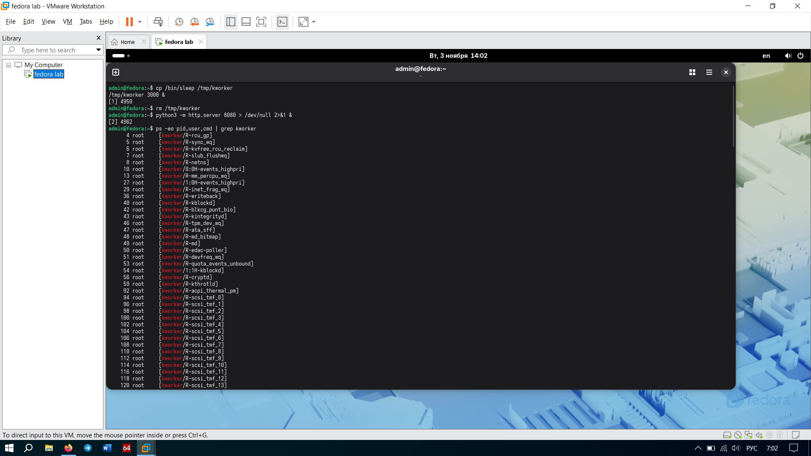
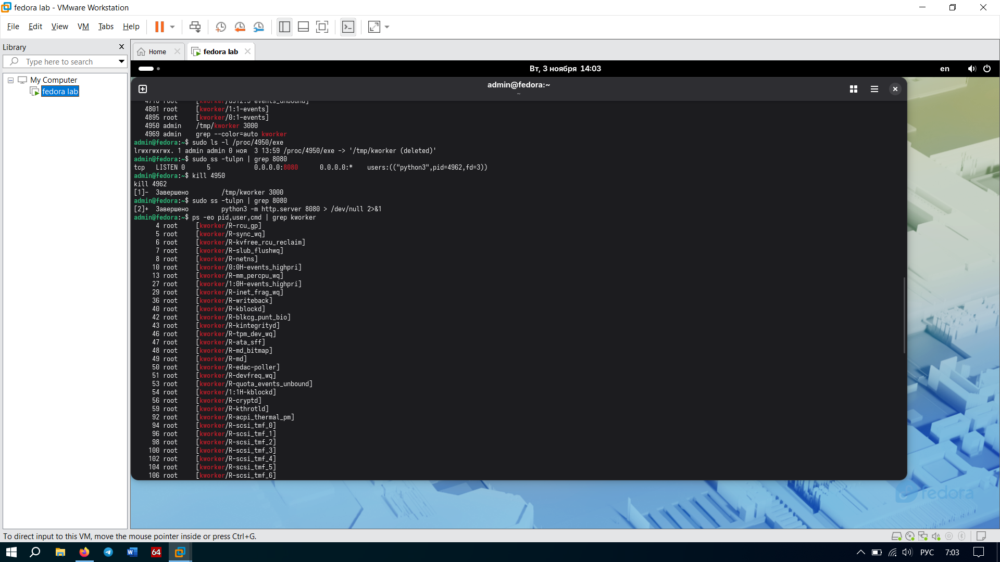

# Задание 6. Расследование инцидента

## 1. Что обнаружено
В ходе расследования обнаружены два подозрительных процесса:
1. Фейковый процесс `kworker` с PID **4950**. Владелец: `admin`. Родитель: `bash`.
2. Процесс `python3`, слушающий порт 8080, с PID **4962**. Владелец: `admin`.

## 2. По каким признакам нашли
*   **Подозрительное имя:** Команда `ps -eo pid,user,cmd | grep kworker` показала, что настоящие системные потоки ядра пишутся в квадратных скобках `[kworker/...]`. Наш фейк был без скобок — просто `/tmp/kworker 3000`.
*   **Запуск из временной папки и удаленный файл:** Команда `sudo ls -l /proc/4950/exe` показала путь `/tmp/kworker (deleted)`. То есть файл запустили из `/tmp`, а потом удалили с диска, чтобы скрыть следы. Процесс при этом остался в памяти.
*   **Открытый сетевой порт:** Команды `sudo ss -tulpn | grep 8080` и `sudo lsof -i :8080` показали, что процесс `python3` (PID 4962) слушает порт 8080. Это подозрительно, так как мы не запускали никаких веб-серверов.

## 3. Почему это подозрительно
Системные процессы (`kworker`) не могут запускаться из пользовательской папки `/tmp` обычным юзером `admin`. Удаление файла с диска (пометка `deleted`) — классический прием малвари, чтобы файл нельзя было просканировать антивирусом. Открытие левого сетевого порта — это потенциальный бэкдор для удаленного управления.

## 4. Как устранено
Оба процесса были убиты командами `kill 4950` и `kill 4962`. После этого проверка через `sudo ss -tulpn | grep 8080` показала, что порт закрыт, а `ps -eo pid,user,cmd | grep kworker` подтвердил, что фейковый процесс исчез (остались только системные в скобках). Угроза снята.

## 5. Вывод
При поиске вредоносного процесса нельзя доверять его имени (малварь легко маскируется под `kworker` или `sshd`). Единственный надежный источник правды — это файл `/proc/[PID]/exe`, который указывает на реальный исполняемый файл в памяти, даже если он удален с диска.

## Скриншоты

